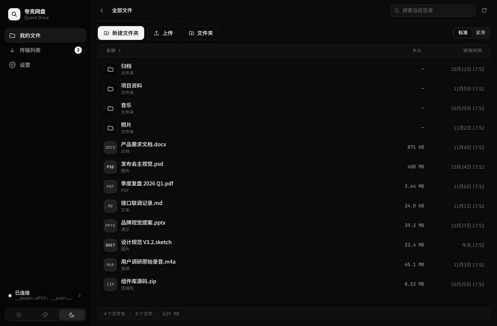
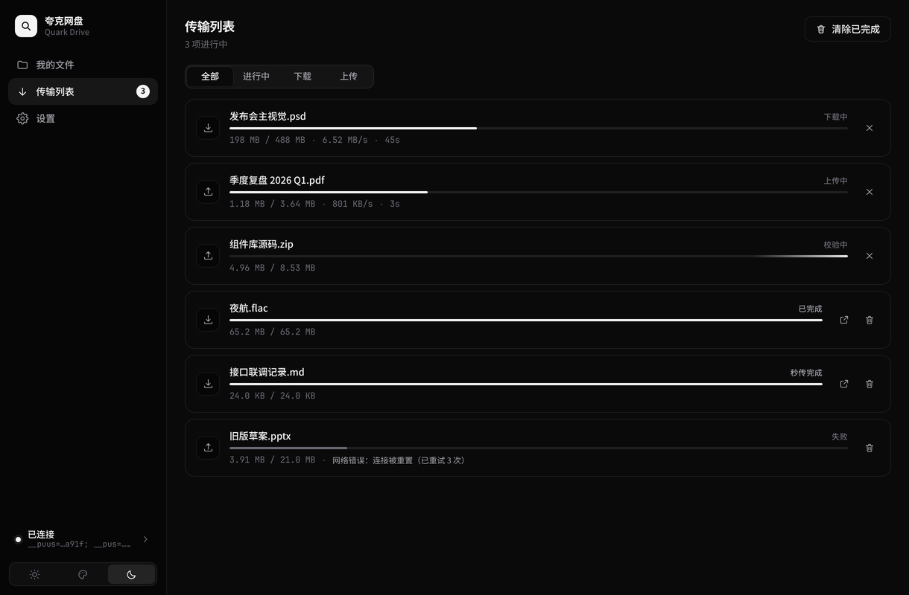
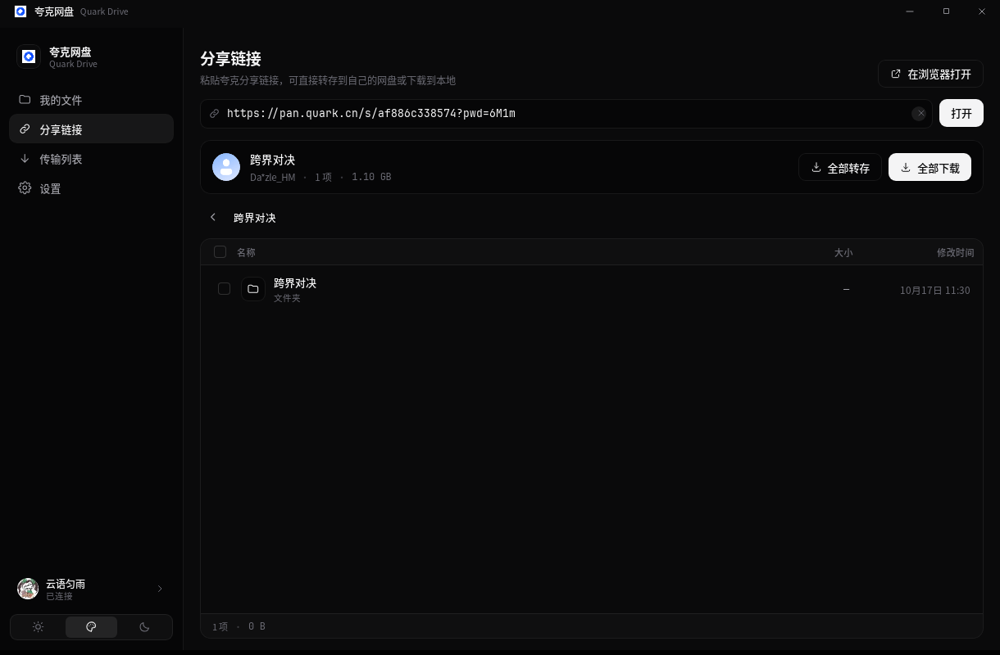

# 云语聚合网盘 (Yunyu Drive)

一个 Linux 桌面客户端，把 **夸克网盘 / 中国移动云盘 / 阿里云盘 / 123 云盘 / 百度网盘** 装进同一个窗口：
一套文件浏览、一套上传下载队列、一套传输列表。使用 **Tauri 2 + Vue 3** 构建，
面向 Debian 13 / KDE 6 / Wayland 调优。

仓库目录名、包名、可执行文件名统一为 `yunyu-drive`（deb 包名 `Yunyu Drive_<版本>_<架构>.deb`，
因为 deb 的 `Package` 字段只允许 ASCII，显示名「云语聚合网盘」在桌面模板里）。

> 源码里仍能找到 `quark` 的痕迹：那是**五个网盘之一**（`ProviderId::Quark`）以及夸克自己的
> 接口地址与深链 `qklink://`（夸克官网「打开客户端」按钮会触发它）。这些都不是历史残留。

| 文件（深色） | 文件（浅色） |
| --- | --- |
|  |  |

| 传输列表（深色） | 设置（浅色） |
| --- | --- |
|  |  |

| 分享链接（深色） | 分享链接（浅色） |
| --- | --- |
|  |  |

## 支持的网盘

| 网盘 | 登录方式 | 后端 | 说明 |
| --- | --- | --- | --- |
| 夸克网盘 | 内置网页登录抓 Cookie / 粘贴 Cookie | [libquarkpan](../quark-cli)（GPL-3.0） | 功能最全：分享链接、转存、秒传 |
| 中国移动云盘 | 内置网页登录抓 Cookie / 粘贴 token | [cloud139](../cloud139)（MIT） | 路径寻址，内部用 base64 路径 id；上传自建四步协议以支持校验进度；不支持创建分享 |
| 阿里云盘 | 扫码登录 / 粘贴 refresh_token | 自实现，网页版 `api.aliyundrive.com` | 需要 ECDSA 设备签名，见下 |
| 123 云盘 | 账号 + 密码 | 自实现，安卓协议移植 | 移动走 `mod_pid`；复制走 `copy/async`（原地复制再移动，见下） |
| 百度网盘 | 内置网页登录抓 Cookie / 粘贴 Cookie | 自实现，网页版 `pan.baidu.com/api` | 走网页会话（`BDUSS` + `PANPSC` 等整包 cookie + `bdstoken`），不需要开发者 app_key |

侧边栏切换网盘即可，每个盘的登录状态、容量条、文件列表互相独立。切到未登录的盘时，文件列表
显示「未登录，请先登录」和一个「去登录」按钮，点它**直接进入该盘的登录页**（不再多问一次
「要登录哪个网盘」）。左下角的账号区也跟着当前网盘走，点开是一个气泡框：账号、状态、容量，
以及「设置 / 退出账号」。

## 特性

- **纯黑白双主题**：浅色 / 深色两套令牌（`src/styles/tokens.css`），可跟随系统自动切换；
  原生窗口装饰也同步换色（`getCurrentWindow().setTheme`）。「跟随系统」不依赖
  `prefers-color-scheme`（WebKitGTK 在 KDE/Wayland 下常解析成浅色），而是由 Rust 侧
  `theme.rs` 直接读 `kdeglobals` 的窗口背景亮度（回退 GTK `settings.ini`、KDE 会话），
  再通过 `system_theme` 命令交给前端。
- **流畅动效**：统一缓动曲线与 4 档时长（110 / 190 / 300 / 460 ms），视图切换、列表进入、
  弹出层均有过渡，并尊重系统的「减少动态效果」设置。
- **完整的文件管理**：多级目录浏览与面包屑、**全盘搜索**、排序（记忆上次选择）、网格/紧凑两种密度、
  多选（Shift / Ctrl / Ctrl+A / ↑↓ 移动光标、Shift+↑↓ 扩选）、右键菜单、新建文件夹、重命名、
  删除、移动、复制。当前网盘不具备的操作会提前灰掉，而不是选完目标目录才报错。
- **搜索走服务端索引**：夸克 `/file/search`、阿里 `/adrive/v3/file/search`、123 `/api/file/list/new`
  的 `SearchData`、百度 `/api/search?recursion=1`——不再逐目录爬树，因此深层目录也能搜到
  （旧实现走 80 个目录就停）。命中项显示所在文件夹，可直接定位。139 的搜索接口上游返回
  「服务不可用」，暂用本地遍历兜底。
- **回收站**：夸克 / 123 云盘 / 阿里云盘各有一个「回收站」入口（侧栏只在支持的网盘显示），
  可多选恢复、彻底删除；阿里云盘只能整站清空（它的 API 没有单条彻底删除），123 云盘只能恢复
  （没有彻底删除接口）。百度网盘与 139 的回收站接口需要人机验证 / `mcloud-sign` 签名，未接入，
  这两个网盘删除时提示「永久删除」。文件列表的删除确认文案也会跟着变（「移入回收站，可以再恢复」）。
- **网格缩略图**：网格模式对图片与视频显示真实预览。预览 URL 由各网盘列表接口直接给出
  （阿里 `image_thumbnail_process` / `video_thumbnail_process`、百度 `thumbs.url2`、139
  `thumbnailUrls`），但 CSP 只允许 `data:`，所以由后端带上网盘要求的 `Referer` 下载后内联
  （阿里预览 CDN 缺 referer 会 403）。前端同一 URL 只取一次、并发 4 个，失败自动回退到文件图标。
  夸克与 123 的列表接口不返回预览地址，这两个网盘仍是文件图标。
- **跨网盘复制 / 移动**：移动或复制的目标盘可以和源盘不同（弹窗顶部切换目标网盘）。
  服务端没有跨盘原语，所以任务会先把文件下载到 `~/.cache/yunyu-drive/cross/` 再上传到目标盘，
  整批选择合成一个任务、在传输列表里以「跨盘复制 / 跨盘移动」显示，可以暂停、重试（只重跑
  剩下的文件）、取消；移动只有在全部文件都落地后才删除源文件，中途失败不会丢数据。
- **大目录不会卡死**：列表只挂载前 200 行，滚到底部再续 200（状态栏显示「已显示 N / M」）；
  ↑↓ 走到未挂载的行会自动补上。
- **容量显示**：侧边栏底部一条容量条，设置页每个网盘一行（已用 / 总量）；网盘不报容量时
  静默隐藏，不显示估算值。左下角账号气泡里也显示同一个数字。
- **五个网盘都显示真实头像和昵称**：左下角账号区随当前网盘切换头像与用户名。头像由 Rust 侧
  下载后内联成 `data:` URL（CSP 不允许远程图片），结果缓存在凭据文件里，第二次启动不再联网；
  拿不到头像时回退到昵称首字。网盘选择器保持原样（网盘徽标 + 昵称）。
- **上传下载**：拖拽上传、多文件上传、**整个文件夹递归上传 / 递归下载**、同名文件自动追加序号或跳过、
  秒传识别、并发数可调（超出的任务自动排队）、取消 / 重试 / 清理、断点续传（`.part` + 任务文件）、
  **全局速度上限**（不限 / 512K / 2M / 5M / 10M，上传下载共享；按已写字节与时间的比值补等待，
  实测 64 KiB/s 上限对应 64 KiB/s、256 KiB/s 上传上限对应 248 KiB/s）。
- **传输列表**：实时进度、速度、剩余时间、状态机（排队 / 校验 / 传输 / 完成 / 失败 / 取消）、
  每个任务带网盘徽标，历史记录持久化（重启后保留，未完成任务恢复为暂停）。
  下载完成后可直接「打开文件」，或「在文件夹中显示」。
- **分享链接（五个网盘都支持）**：「分享链接」页粘贴链接即可预览分享内容、逐级浏览子目录、
  批量**转存**到自己网盘或**下载**到本地。识别夸克、中国移动云盘、阿里云盘、123 云盘、百度网盘
  五种链接（`?pwd=` 直接认，没有就填右边的「提取码」框）。
  支持系统级深链 `yunyu-drive://share?url=<encodeURIComponent(链接)>`；
  夸克官网的 `qklink://` / `qkclouddrive://` 也照收。
  各盘差异见下面「分享链接的实现差异」。
- **创建分享（四个网盘，139 除外）**：选中文件或文件夹右键「创建分享链接」，可选分享名称、
  有效期（永久 / 7 天 / 30 天）和 4 位提取码，创建完直接复制链接，也能在弹窗里「取消分享」。
  各盘限制见下面「创建分享的实现差异」。
- **我的分享**：侧栏「我的分享」列出当前网盘里已经创建的分享——标题、链接、提取码、
  到期时间、浏览 / 转存 / 下载次数，可以复制链接或直接取消；已过期的收在折叠区里。
  五个网盘都能列。
- **登录凭据只存本地**：`~/.config/yunyu-drive/`（0600）。

## 文档

- [Tauri + WebKitGTK 页面切换闪烁的成因与修法](docs/tauri-webkitgtk-flicker.md)
  ——"浏览器里正常、打包成 deb 后闪一下旧页面"的完整排查与修法，含可复用的逐帧诊断脚本。

## 构建

依赖：Rust 1.8x、Node 20+、`libwebkit2gtk-4.1-dev`、`libgtk-3-dev`、`libsoup-3.0-dev`。

```bash
pnpm install                # 仓库只留 pnpm-lock.yaml（npm 也能装，但没有锁文件）
pnpm tauri build            # 产物：src-tauri/target/release/bundle/deb/*.deb
```

开发模式下 `pnpm dev` 起 Vite（5183），`pnpm tauri dev` 起桌面窗口。
注意 `tauri-plugin-single-instance` 会让 release 版被残留的 dev 进程顶掉，
切换前先 `pkill -f "tauri.js dev"`。

`.gitignore` 已覆盖 `node_modules/`、`dist/`、`src-tauri/target/`（后者单打独斗就 20+ GB）、
`src-tauri/gen/schemas/`（tauri-build 每次重写）与各类包产物，可以直接 `git init`。

### 使用 mock 后端预览界面

没有有效登录凭据时可以脱离 Tauri 在浏览器里走查全部界面：

```bash
VITE_MOCK=1 pnpm dev        # http://localhost:5183/?view=files&theme=dark
```

`vite.config.ts` 会用别名把 `@/lib/backend` 指向 `src/lib/backend.mock.ts`，
因此 **mock 数据不会被编进正式包**（可用 `grep 发布会主视觉 dist/assets/*.js` 验证）。
支持的 query：`view=files|transfers|settings|login`、`theme=light|dark`。

## 系统集成

`.deb` 安装后注册 `x-scheme-handler/yunyu-drive`，因此以下两种方式都会唤起客户端：

```bash
xdg-open "yunyu-drive://share?url=https%3A%2F%2Fpan.quark.cn%2Fs%2Faf886c338574%3Fpwd%3D6M1m"
yunyu-drive "yunyu-drive://share?url=..."
```

## 结构

```
yunyu-drive/             ← 本仓库（前端 + Tauri 壳）
  .gitignore             前端 / Rust / 包产物
  pnpm-lock.yaml         唯一锁文件（pnpm 12）
  pnpm-workspace.yaml    allowBuilds: esbuild
  src/                   前端（见下）
  src-tauri/             Rust 侧与打包配置
  docs/                  截图与排查笔记
```

`src-tauri/Cargo.toml` 用相对路径链接了同级的两个本地 crate：
`../../quark-cli/libquarkpan`（夸克，GPL-3.0）与 `../../cloud139`（中国移动云盘，MIT）。
如果要把仓库单独拷走，记得一并带上这两个目录，或把它们改成 git 依赖。

```
src/
  components/      Sidebar、Segmented、Modal、EmptyState、Toasts、Icon、FileIcon、
                   AliyunQrLogin（扫码登录）、ProviderBadge、DriveLoader（转圈加载）…
  views/           FilesView / RecycleView / TransfersView / SettingsView / LoginView / ShareView
  store/app.ts     全局状态（含每盘登录态、容量）+ 主题 + 启动编排
  lib/api.ts       全部 Tauri 命令的类型化封装
  lib/host.ts      原生能力桥（对话框 / 打开所在目录 / 拖拽 / 窗口主题），浏览器降级
  lib/mock.ts      内存版后端（fixtures + 模拟进度）
  lib/types.ts     PROVIDERS（名称、徽标、能力）与 DTO 类型
  lib/motion.ts    popup 动画（WAAPI；CSS transition 在 WebKitGTK 上不逐帧推进）
  styles/          tokens.css（设计令牌）+ global.css（原语与过渡）
src-tauri/src/
  providers/       DriveProvider 抽象 + 五个网盘适配器
    mod.rs           trait、EntryId（`<provider>:<native>`）、Capabilities、注册表
    quark.rs         夸克（libquarkpan）
    yun139.rs        中国移动云盘（cloud139，路径 ↔ base64 id）
    aliyun.rs        阿里云盘（网页版 API + ECDSA 设备签名）
    aliyun_qr.rs     阿里扫码登录（passport 二维码 → web token）
    pan123.rs        123 云盘（安卓协议）
    baidu.rs         百度网盘（网页版 cookie 会话 + 4 MiB 分片上传）
  commands.rs      网盘无关的 IPC 层（登录、列表、文件操作、配额、传输）
  transfer.rs      传输任务队列、并发限流、持久化、断点续传
  share.rs         分享链接分发（解析链接 → 交给对应网盘）、账户信息、流式下载
  share_live.rs    分享链路的真机探针（`cargo test --lib share_live -- --ignored --nocapture`）
  login.rs         内置网页登录窗口与 Cookie 抓取（夸克 / 139 / 百度共用一套流程）
  bridge.rs        `qklink://` 浏览器桥（端口 9125-9130）
  config.rs        路径与设置、旧配置迁移
  error.rs         错误 → 中文文案
```

## 说明

- 夸克接口没有「原地覆盖」原语，因此重名策略为「自动重命名」或「跳过」。
- 阿里云盘的网页版接口需要 `x-device-id` + `x-signature`（secp256k1 over
  `appId:deviceId:userId:0`，首次调用 `/users/v1/users/device/create_session` 注册公钥），
  因此**扫码得到的 token 必须在登录时先注册设备**，否则列目录会报
  `DeviceSessionSignatureInvalid`。
- 阿里云盘一个账号有两个盘：`default_drive_id`（系统建的 `Default`，通常只有几 MB）和
  `resource_drive_id`（手机上看到的那个，几十 GB）。列表会按 `used_size` 比较一次，
  用大的那个，并把结果写进 `aliyun.json` 的 `drive_chosen`，之后不再改判。
  旧逻辑是「默认盘为空才切」，只要往默认盘写过任何东西（转存副本、上传）就会永远卡在默认盘，
  表现为「手机上几百个文件，电脑上只有一两个」。
- 123 云盘的移动走 `/b/api/file/mod_pid`；盘内复制走 `copy/async`。注意 `/file/copy`
  （不带 `async`）要求 `ShareKey`，那是转存分享而不是盘内复制，不要混用。

### 创建分享的实现差异

`create_share` / `revoke_share` 是 provider 的可选能力（`Capabilities.share_create`），
`share.rs` 只做参数校验与 id 转换：

| 网盘 | 创建 | 取消 | 限制 |
| --- | --- | --- | --- |
| 夸克 | `POST /1/clouddrive/share` → `share/password` 换链接 | `share/delete` | 有效期只有永久 / 1 / 7 / 30 天 |
| 123 云盘 | `POST /b/api/share/create` | `/b/api/share/delete` | `fileIdList` 是逗号分隔字符串，`expiration` 必填且带时区 |
| 阿里云盘 | `POST /adrive/v2/share_link/create` | `adrive/v4/batch` 的 `/share_link/cancel` | 每日创建次数有上限（`SharelinkCreateExceedDailyLimit`） |
| 百度网盘 | `POST /share/set`（`schannel=4`） | `/share/cancel` | **必须有 4 位提取码**，没填就随机生成 |
| 中国移动云盘 | `POST /richlifeApp/devapp/IOutLink/getOutLink`（share 主机） | 同主机的 `IOutLink/delOutLink` | 提取码由服务端生成，不能自定义；有效期只有永久 / 1 / 7 / 30 天 |

对应的列表接口（`share_records`，供「我的分享」页用）：

| 网盘 | 列表端点 | 标题来源 | 提取码 |
| --- | --- | --- | --- |
| 夸克 | `GET /1/clouddrive/share/mypage/detail`（**必须 GET，POST 回 405**） | `title` | `passcode` |
| 123 云盘 | `GET /b/api/share/list` | `ShareName`（自己建的时候填的） | `SharePwd`（只有这里会回显） |
| 阿里云盘 | `POST /adrive/v3/share_link/list`（**要设备签名，裸 token 回 403**） | `share_name` | `share_pwd` |
| 百度网盘 | `GET /share/record` | `typicalPath` 的最后一段（`name` 恒为 `"0"`） | **恒空** |
| 中国移动云盘 | `POST /IOutLink/getOutLinkLst`（share 主机） | `lkName` | `passwd` |

- 夸克和 123 把「永久」记成 `4102416000000` / `9999-12-31T23:59:59+08:00`，
  归一化时按 2100 年截断回 0，否则界面会显示「9999 年到期」。
- 百度拿不到提取码（`passwd` 恒空），123 的 `/b/api/share/info` 也不回显，
  所以这两个盘的「复制链接」只复制 URL，提取码需要用户自己记得。

- 夸克的创建端点**不是** `/1/clouddrive/share/create`（404），而是 `/1/clouddrive/share`；
  返回的 `share_id` 是 32 位 hex，还要再调 `share/password` 才拿到 12 位 `pwd_id` 和链接。
- 123 的密码字段是 **`sharePwd`** 而不是 `pwd` —— 传 `pwd` 服务端照收但静默忽略，分享变成无码。
  分享链接在 `data.shareLinkList.list[0]`，`data.ShareUrl` 恒为空串。
- 阿里不传 `expiration` 才是永久（传空串会被拒），`share_id` 是 11 位 base62；
  取消只能用 `adrive/v4/batch` 的 `/share_link/cancel`，`/share_link/delete` 是 404。
- 百度 `path_list` 是 **JSON 数组字符串**且必须是绝对路径，`pwd` 为空会回
  `pwd length param error`，`schannel=0`（无密码）直接回「账号异常，禁止分享」。
- 139 的分享接口在 **`share-kd-njs.yun.139.com/yun-share`**，不在 `personal-kd-njs`
  上（后者整体 503）。三个端点都要 `x-yun-userDomainId: enabled` 请求头 **且**
  请求体里带数字 `userDomainId`（从 `user-njs` 的 `user/getUser` 取）——少任何一个都回
  `200000401 IP鉴权失败、用户账号鉴权失败`，看起来和「登录过期」一模一样。
  文件进 `coIDLst.item`、文件夹进 `caIDLst.item`，两者都是服务端自己的 `fileId`；
  `delOutLink` 的 `linkIDs` 必须是 `{"item": [...]}` 而不是数组。

### 分享链接的实现差异

五个网盘的分享协议完全不同，`share.rs` 只负责按域名认出网盘，其余都交给各 provider 的
`share_open` / `share_list` / `share_save` / `share_walk` / `share_link` / `share_cleanup`：

| 网盘 | 浏览 | 转存 | 直接下载 |
| --- | --- | --- | --- |
| 夸克 | `sharepage/token` + `sharepage/detail` | `sharepage/save` + 任务轮询 | `file/share/download` |
| 中国移动云盘 | AES-128-CBC 包体的 `getOutLinkInfoV6` | `createOuterLinkBatchOprTask` | `dlFromOutLinkV3`（预签名 15 分钟） |
| 阿里云盘 | `share_link/get_share_token` + `adrive/v3/file/list` | `adrive/v2/batch` 的 `/file/copy` | **先转存副本，再对副本取直链，下完删副本** |
| 123 云盘 | `/b/api/share/get` | `/api/restful/goapi/v1/file/copy/save` | `/b/api/share/download/info`（必须 `platform: android`） |
| 百度网盘 | `/share/list`（目录用路径寻址） | `/share/transfer` | 仅 < 52 MB；大文件提示先转存 |

几个踩过的坑：

- 阿里云盘 `/v2/file/get_download_url` 对几十 MB 以上的文件会返回**空 `url`**，
  必须带 `X-Canary: client=android,app=adrive,version=v6.9.0` 才给链接（普通文件下载同理）。
- 123 的分享下载必须带 `platform: android`（`web`/`linux` 会回「分享方提取流量包不足」），
  并且要带自己的账号 token；转存的目标目录只认 `fileList[0].parentFileID`。
- 139 的分享接口全部是 AES-128-CBC 加密的裸 base64 请求体，且缺 `X-Deviceinfo` /
  `hcy-cool-flag` 会直接回「功能参数值非法」；`dlFromOutLinkV3` 还必须带 `Authorization`。
- 百度分享的子目录是**路径**而不是 id，且不能转存自己创建的分享（`errno: 2`）。
- 123 的「复制」是 `POST /api/restful/goapi/v1/file/copy/async`，body 必须是**小写**
  `{"fileList":[{"fileId":…,"size":…,"etag":…,"type":0,"parentFileId":…,"fileName":…,"driveId":0}],"targetFileId":<目标文件夹>}`。
  用安卓风格的 `{"FileId":…}` + 顶层 `parentFileId` 会回 `code: 0` 但**什么都不复制**（静默空转），
  这也是之前把 123 的「复制」标成不支持的原因。
- 五个网盘的列表排序由同一段代码决定（文件夹优先，再按名称小写排序），
  时间戳也由同一个 `parse_time` 解析——123 的 `UpdateAt` 是 ISO 字符串、百度是秒、
  夸克是毫秒，各读一种形状会让列表显示 1970。
- 139 的上传是自建的四步协议（`file/create` → 逐片 `PUT` → `file/complete`），
  因为 crate 的 `upload()` 没有进度回调；重命名 / 移动后会更新路径缓存，
  否则面包屑和后续操作会指向旧路径。
- 百度网盘走网页会话：内置窗口登录后抓 `pan.baidu.com` 的整包 cookie，再用
  `/api/gettemplatevariable` 换 `bdstoken`。注意网页会话**不是**只靠 `BDUSS`/`STOKEN`：
  少 `PANPSC` 时接口一律回 `errno: -6`（未登录），所以登录窗口会等到 `pan.baidu.com`
  的 cookie 出现才收割，并且收割时不做名字白名单（百度会改名、加 `*_BFESS` 变体）。
  上传按 4 MiB 切片（`block_list` 是每片的 md5，`slice-md5` 取前 256 KiB），
  服务端已有同样文件时秒传；百度不允许上传空文件。
  下载先用 `/api/filemetas` 取 `dlink`（**不要带 `origin=dlna`**，那样拿到的地址会被 CDN
  以 `error_code 31329` 拒掉），再 `HEAD` 拿 CDN 的 `Location`，`Range` 请求返回 `206`。
- 递归下载会把文件夹展平为「每个文件一个任务」，本地按原目录结构落盘，方便单独取消与续传。
- 传输记录保存在 `~/.config/yunyu-drive/transfers.json`，日志目录
  `~/.local/share/yunyu-drive/logs`。

### 头像与昵称的来源

侧栏的头像/昵称来自 `provider_profiles` 命令（与 `auth_states` 分开：前者要联网，
不能让文件列表等它）。每个网盘的资料接口都不一样：

| 网盘 | 接口 | 昵称 / 头像字段 |
| --- | --- | --- |
| 夸克 | `pan.quark.cn/account/info` | `nickname` / `avatarUri` |
| 中国移动云盘 | `user-njs.yun.139.com/user/getUser` | `data.userProfileInfo.auditNickName` / `bigAvatarUrl` |
| 阿里云盘 | 登录时的 `/v2/user/get` | `nick_name` / `avatar`（`img.aliyundrive.com`） |
| 123 云盘 | `/b/api/user/info` | `data.Nickname` / `data.HeadImage` |
| 百度网盘 | 登录时的 cookie 收割 | `username` / `avatar`（`himg.bdimg.com`） |

坑：139 的 `/user/getUser` 用的是**AES-256-CBC**（key `UqEZkrjCKfa02pP6jntzFmkzOz86zHUC`，
32 字节），和分享接口的 AES-128 不是一套；而且**请求体也必须加密**，发明文会回
`01000019 动态解密错误`。响应是裸 base64 而不是 JSON。`cloud139` 的 `aes_cbc_encrypt`
写死了 `Aes128`，所以 `yun139.rs` 里另写了一份 `aes256_cbc_*`（依赖 `aes` + `cbc`）。

### 窗口尺寸与响应式

窗口最小尺寸是 `940 × 620`（`src-tauri/tauri.conf.json`），默认 `1220 × 800`。布局按
「内容宽 = 窗口宽 − 侧栏 224px − 内边距 32px」估算，只在真正放不下的地方收缩：

| 位置 | 做法 |
| --- | --- |
| 文件列表动作栏 | 选中文件后共 9 个按钮 + 已选计数 + 视图切换，单行需要约 987px 内容宽（≈1243px 窗口）。`≤1279px` 收紧按钮内边距与间距（降到约 907px，覆盖默认 1220px 窗口）；`≤1179px` 隐藏按钮文字只留图标（约 389px），每个按钮都带 `title` 保证可读。动作栏同时允许换行作为兜底 |
| 搜索框 | `flex: 0 1 210px; min-width: 120px`——先于面包屑收缩，因为面包屑是唯一的位置提示 |
| 文件名 / 大小 / 时间三列 | 固定 `96px 148px`，名称列 `minmax(0, 1fr)` 加省略号；最小窗口下仍够用，不加断点 |
| 网格视图 | `repeat(auto-fill, minmax(132px, 1fr))`，天然自适应 |
| 侧栏 | 固定 224px，内容总高 359px，`420px` 高的窗口也不会溢出，不加断点 |
| 分享页 / 设置页 / 传输页 / 登录页 | 本身用 `flex` + `max-width` + `minmax(0,1fr)`，`700 × 480` 下实测无溢出 |
| 弹窗 | `.modal { max-width: 100%; max-height: 100% }` + `.modal-body { overflow: auto }`，重命名 / 移动 / 下载弹窗在 `700 × 480` 下无溢出 |

改完用 headless Chrome + CDP 的 `Emulation.setDeviceMetricsOverride` 逐尺寸扫（5 个视图 ×
940/880/820/760/700 宽 × 620/560/480 高），判定标准是「元素超出视口且祖先没有对应轴向的
`overflow: auto|scroll`」。注意 `.list-body` 是滚动容器，里面的内容超出可视区是正常滚动，
不是裁切——探针必须排除滚动容器内的元素，否则会误报一堆 `BELOW`。

## 许可

整体以 **GPL-3.0-or-later** 发布，详见 [LICENSE](LICENSE) 与 [NOTICE](NOTICE)
（NOTICE 区分了实际链接的库与仅作协议参考的上游项目）。
