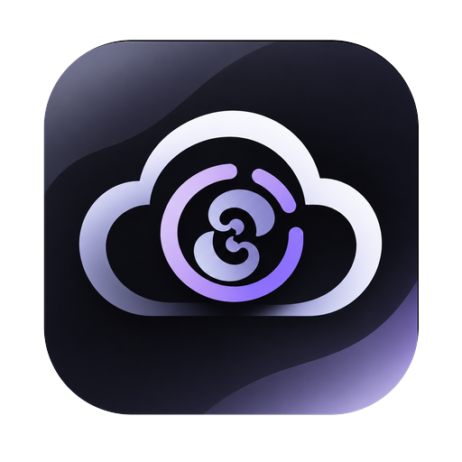
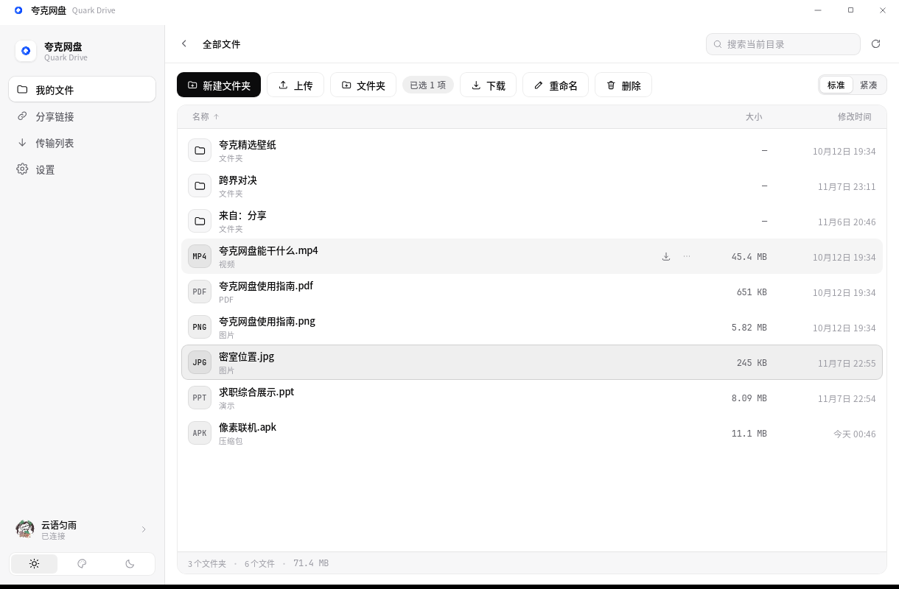
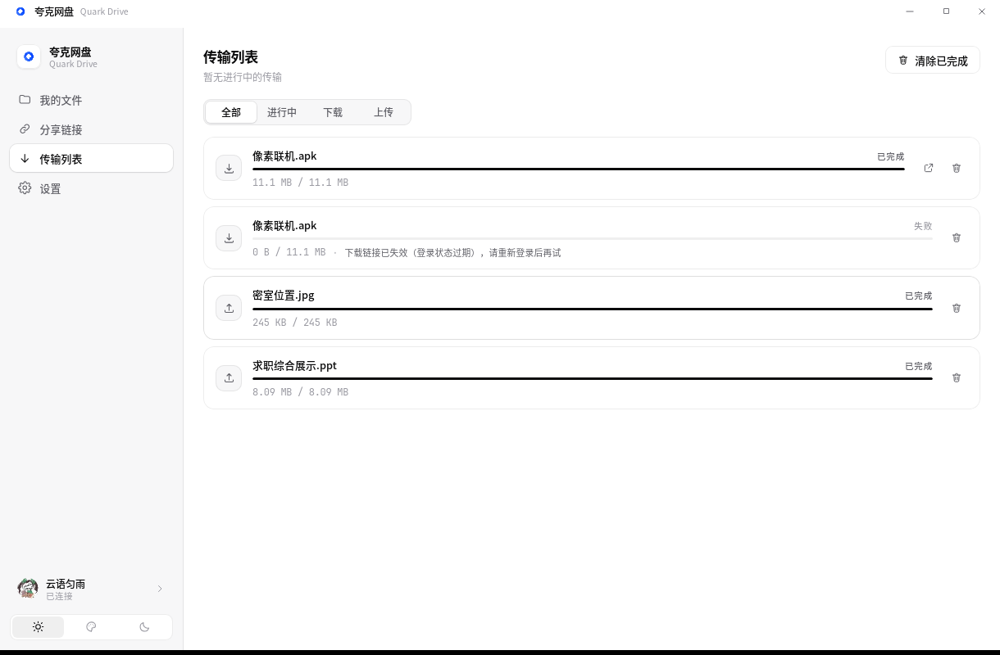
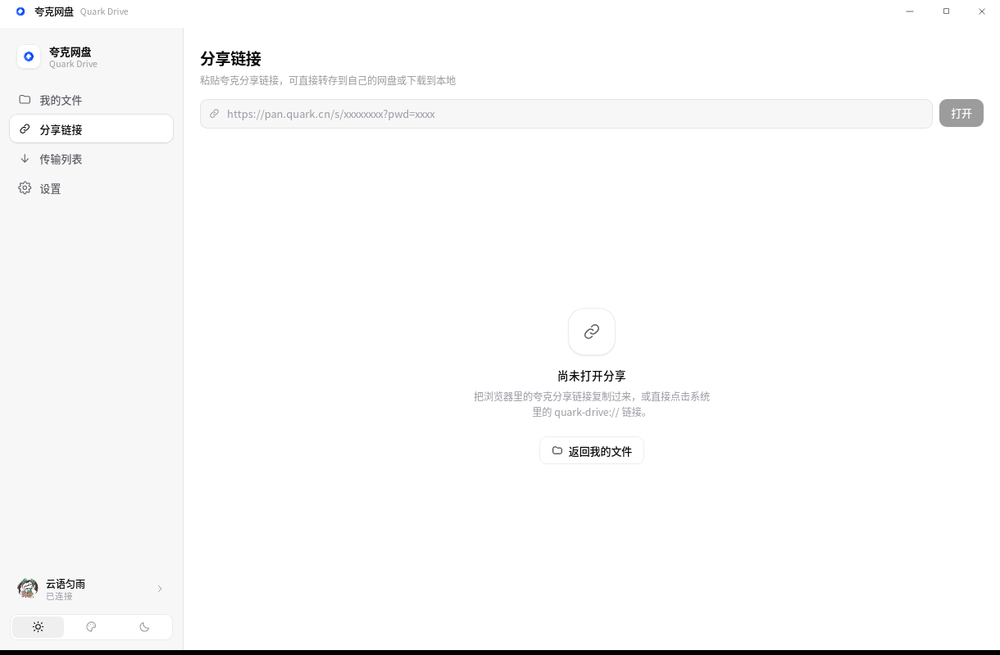
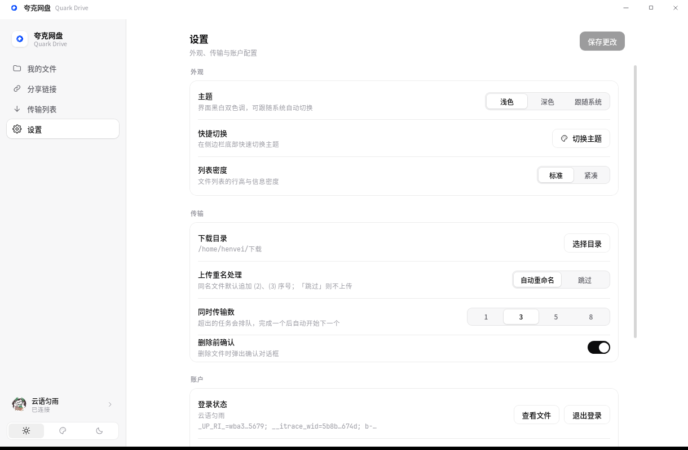

<div align="center">



# 云语聚合网盘

**把夸克、中国移动云盘、阿里云盘、123 云盘、百度网盘装进同一个窗口。**

一套文件浏览、一套上传下载队列、一套传输列表、一套分享流程。

[](https://github.com/4YStudio/yunyu-drive/releases/latest)
[](https://github.com/4YStudio/yunyu-drive/actions/workflows/release.yml)
[](LICENSE)
[](https://tauri.app)
[](https://vuejs.org)

[**下载安装**](#下载安装) · [**官网**](https://4ystudio.github.io/yunyu-drive/) · [**功能**](#功能) · [**支持的网盘**](#支持的网盘) · [**从源码构建**](#从源码构建) · [**实现笔记**](#实现笔记)

> 官网是纯静态的，源码在 [`docs/`](docs/index.html)，由 [`pages.yml`](.github/workflows/pages.yml) 自动发布到 GitHub Pages。

</div>

<picture>
  <source media="(prefers-color-scheme: dark)" srcset="docs/files-dark.png" />
  
</picture>

---

## 功能

<table>
<tr>
<td width="50%" valign="top">

**五盘合一**

侧边栏切换网盘，登录状态、容量条、文件列表互相独立。
每个盘有独立的头像、昵称与「关于」信息，左下角账号区跟着当前网盘走。

**纯黑白双主题**

浅色 / 深色两套设计令牌，可跟随系统自动切换，原生窗口装饰也同步换色。
「跟随系统」不依赖 `prefers-color-scheme`——WebKitGTK 在 KDE/Wayland 下常把它解析成浅色，
所以由 Rust 侧直接读 `kdeglobals` 的窗口背景亮度来判断。

**完整的文件管理**

多级目录与面包屑、全盘搜索、排序（记忆上次选择）、网格 / 紧凑两种密度、
多选（Shift / Ctrl / Ctrl+A / ↑↓ / Shift+↑↓）、右键菜单、新建文件夹、
重命名、删除、移动、复制。当前网盘不具备的操作会提前灰掉，
而不是选完目标目录才报错。

**搜索走服务端索引**

夸克 `/file/search`、阿里 `/adrive/v3/file/search`、123 `/api/file/list/new`、
百度 `/api/search?recursion=1`——不再逐目录爬树，因此深层目录也能搜到。
命中项显示所在文件夹，可直接定位。

</td>
<td width="50%" valign="top">

**跨网盘复制 / 移动**

目标盘可以和源盘不同（弹窗顶部切换目标网盘）。服务端没有跨盘原语，
所以任务会先下载到 `~/.cache/yunyu-drive/cross/` 再上传到目标盘；
整批选择合成一个任务，可暂停、重试（只重跑剩下的文件）、取消。
移动只有在全部文件都落地后才删除源文件，中途失败不会丢数据。

**上传下载**

拖拽上传、多文件、整个文件夹递归上传 / 下载、同名自动追加序号或跳过、
秒传识别、并发数可调、取消 / 重试 / 清理、断点续传（`.part` + 任务文件）、
全局速度上限（不限 / 512K / 2M / 5M / 10M，上传下载共享）。
传输列表会显示当前**有多少条连接在跑**、分片进度（`256 线程 · 719/1953 片`），
一眼能看出慢是因为盘不认 `Range`（只有 1 条连接），还是池子已经开满。

**分段并发下载**

夸克与阿里云盘走多连接分段下载：按文件大小自适应连接数（8 MB 以下单流，
1 GB 以上最多 512 路），每路只取一段区间，谁先完成谁再领新片，
慢连接会被判定后换新连接而不是拖死整个任务。
直链过期、CDN 回 200 错误页、服务端不认 `Range` 都有对应处理，
断点续传把分片计划写进 `.part.yyparts`，重启后按原偏移继续。

**分享链接（五个盘都支持）**

粘贴链接即可预览、逐级浏览子目录、批量转存到自己网盘或下载到本地。
支持系统深链 `yunyu-drive://share?url=…`，夸克官网的 `qklink://` 也照收。

**创建分享 · 我的分享**

四个盘可建可撤（139 除外）。「我的分享」列出已建分享的标题、链接、提取码、
到期时间与浏览 / 转存 / 下载次数，可以复制链接或直接取消。

</td>
</tr>
</table>

### 界面

| 文件列表 | 传输列表 |
| --- | --- |
| <picture><source media="(prefers-color-scheme: dark)" srcset="docs/files-dark.png" /></picture> | <picture><source media="(prefers-color-scheme: dark)" srcset="docs/transfers-dark.png" /></picture> |

| 分享链接 | 设置 |
| --- | --- |
| <picture><source media="(prefers-color-scheme: dark)" srcset="docs/share-dark.png" /></picture> | <picture><source media="(prefers-color-scheme: dark)" srcset="docs/settings-dark.png" /></picture> |

<sub>截图会跟随 GitHub 的深色 / 浅色模式自动切换。</sub>

### 还有这些细节

- **回收站**：夸克 / 123 云盘 / 阿里云盘各有入口（只在支持的网盘显示），可多选恢复、彻底删除。
  阿里只能整站清空（API 没有单条彻底删除），123 只能恢复。百度与 139 的回收站接口需要
  人机验证 / `mcloud-sign` 签名，未接入，删除时提示「永久删除」——文件列表的确认文案也会跟着变。
- **网格缩略图**：图片与视频显示真实预览。预览 URL 由各网盘列表接口给出，但 CSP 只允许
  `data:`，所以由后端带上网盘要求的 `Referer` 下载后内联（阿里预览 CDN 缺 referer 会 403）。
  前端同一 URL 只取一次、并发 4 个，失败自动回退到文件图标。
- **大目录不会卡死**：列表只挂载前 200 行，滚到底部再续 200（状态栏显示「已显示 N / M」）。
- **五个盘都显示真实头像和昵称**：头像由 Rust 侧下载后内联成 `data:` URL，结果缓存在凭据文件里，
  第二次启动不再联网；拿不到时回退到昵称首字。
- **凭据只存本地**：`~/.config/yunyu-drive/`，权限 `0600`。
- **登录凭据不落日志**，错误统一转成中文文案（`src-tauri/src/error.rs`）。

## 支持的网盘

| 网盘 | 登录方式 | 后端 | 说明 |
| --- | --- | --- | --- |
|  夸克网盘 | 内置网页登录抓 Cookie / 粘贴 Cookie | [libquarkpan](vendor/libquarkpan)（GPL-3.0-only） | 功能最全：分享、转存、秒传 |
|  中国移动云盘 | 内置网页登录抓 Cookie / 粘贴 token | [cloud139](vendor/cloud139)（MIT） | 路径寻址，内部用 base64 路径 id；上传自建四步协议以支持校验进度；不支持创建分享 |
|  阿里云盘 | 扫码登录 / 粘贴 refresh_token | 自实现，网页版 `api.aliyundrive.com` | 需要 ECDSA 设备签名 |
|  123 云盘 | 账号 + 密码 | 自实现，安卓协议移植 | 移动走 `mod_pid`；复制走 `copy/async`（原地复制再移动） |
|  百度网盘 | 内置网页登录抓 Cookie / 粘贴 Cookie | 自实现，网页版 `pan.baidu.com/api` | 网页会话（`BDUSS` + `PANPSC` + `bdstoken`），不需要开发者 app_key |

> 源码里仍能找到 `quark` 的痕迹：那是**五个网盘之一**（`ProviderId::Quark`）以及夸克自己的
> 接口地址与深链 `qklink://`（夸克官网「打开客户端」按钮会触发它）。这些都不是历史残留。

## 下载安装

从 [**Releases**](https://github.com/4YStudio/yunyu-drive/releases/latest) 下载对应平台的安装包：

| 平台 | 文件 | 说明 |
| --- | --- | --- |
| Windows 10 / 11 | `Yunyu-Drive_<版本>_x64-setup.exe` | NSIS 安装器，可选简体中文 / English |
| Debian / Ubuntu | `Yunyu-Drive_<版本>_amd64.deb` | 装完注册 `x-scheme-handler/yunyu-drive` |
| Fedora / openSUSE | `Yunyu-Drive-<版本>-1.x86_64.rpm` | 同上 |
| macOS 10.15+ | `Yunyu-Drive_<版本>_universal.dmg` | 通用二进制，Intel 与 Apple Silicon 同一个包 |

macOS 包默认是 **ad-hoc 签名、未公证**，首次打开需要右键 →「打开」。
Linux 需要 `libwebkit2gtk-4.1`、`libgtk-3-0`、`libayatana-appindicator3-1`（deb / rpm 会自动拉依赖）。

装好之后深链可用：

```bash
xdg-open "yunyu-drive://share?url=https%3A%2F%2Fpan.quark.cn%2Fs%2Faf886c338574%3Fpwd%3D6M1m"
```

## 从源码构建

依赖：**Rust 1.88+**、**Node 20+**、**pnpm 12**，
Linux 上另需 `libwebkit2gtk-4.1-dev`、`libgtk-3-dev`、`libsoup-3.0-dev`、`libayatana-appindicator3-dev`。

```bash
pnpm install
pnpm tauri dev      # 开发（Vite 5183 + 桌面窗口）
pnpm build:linux    # deb + rpm
pnpm build:windows  # Windows：NSIS 安装器
pnpm build:mac      # macOS：通用二进制（Intel + Apple Silicon）dmg
```

产物在 `src-tauri/target/release/bundle/` 下。Tauri 不支持交叉编译，
Windows / macOS 的包必须在对应系统上打（或者交给 CI）。

> 开发模式下 `tauri-plugin-single-instance` 会让 release 版被残留的 dev 进程顶掉，
> 切换前先 `pkill -f "tauri.js dev"`。

### 在浏览器里走查界面

没有有效登录凭据时可以脱离 Tauri 预览全部界面：

```bash
VITE_MOCK=1 pnpm dev        # http://localhost:5183/?view=files&theme=dark
```

`vite.config.ts` 用别名把 `@/lib/backend` 指向 `src/lib/backend.mock.ts`，
因此 **mock 数据不会被编进正式包**。
支持的 query：`view=files|transfers|settings|login|share|myShares|recycle`、`theme=light|dark`。

### 自动发布三平台安装包

[`.github/workflows/release.yml`](.github/workflows/release.yml) 在两种情况下打包：

| 触发 | 行为 |
| --- | --- |
| 推 `v*` 标签 | 三平台并行构建 → 发 GitHub Release 并上传安装包 |
| Actions 页面手动 Run workflow | 默认只构建；填版本号 + 勾选 `publish` 才会发 Release |

日常 push 不触发。完整发版流程：

```bash
pnpm version:set 0.2.0          # 只改 package.json 一处
git commit -am "chore: 0.2.0"
git tag v0.2.0                  # 必须打在已包含 workflow 的提交上
git push && git push origin v0.2.0
```

macOS 正式分发（让用户双击不报「已损坏」）需要在仓库 Secrets 里配好
`APPLE_CERTIFICATE`、`APPLE_CERTIFICATE_PASSWORD`、`APPLE_SIGNING_IDENTITY`、
`APPLE_ID`、`APPLE_PASSWORD`、`APPLE_TEAM_ID`，并删掉 workflow 里的 ad-hoc 签名那一步。

### 官网

[`docs/index.html`](docs/index.html) 是官网单页，纯静态（一个 HTML + 两个资源文件），
没有任何构建步骤。[`.github/workflows/pages.yml`](.github/workflows/pages.yml) 在
`docs/` 有改动时把它发到 GitHub Pages：

| 触发 | 行为 |
| --- | --- |
| push 到 `master` 且 `docs/` 有改动 | 上传 `docs/` 并部署 |
| Actions 页面手动 Run workflow | 同上 |

仓库设置里 **Settings → Pages → Source** 需要选一次 **GitHub Actions**，
之后地址是 <https://4ystudio.github.io/yunyu-drive/>。

官网本地预览：`cd docs && python3 -m http.server 8000`（直接双击 `index.html` 也行，
它没有用到任何需要服务端的能力）。

### 版本号只写在一个地方

唯一真源是 `package.json` 的 `version`，其余全部自动跟随：

| 用途 | 怎么拿到版本 |
| --- | --- |
| 安装包文件名与元数据（deb / rpm / NSIS / dmg） | `src-tauri/tauri.conf.json` 写的是 `"version": "../package.json"` |
| 应用内「关于」页、启动日志、夸克网页桥接 | `src-tauri/build.rs` 注入 `YUNYU_VERSION`，代码里读 `crate::version::VERSION` |
| `src-tauri/Cargo.toml` | 故意不写 `version`（缺省 0.0.0），所以升版本不会牵动 `Cargo.lock` |

注意**不要**用 `env!("CARGO_PKG_VERSION")` 取版本，那样会得到 `0.0.0`。

## 项目结构

```
yunyu-drive/
├── .github/workflows/    release.yml：tag / 手动触发的三平台打包
│                         pages.yml：把 docs/ 发到 GitHub Pages
├── scripts/              tauri.mjs（CLI 包装）、set-version.mjs（改版本号）
├── src/                  前端（Vue 3 + TypeScript）
│   ├── components/       Sidebar、Modal、Segmented、EmptyState、Toasts、Icon、
│   │                     FileIcon、AliyunQrLogin（扫码登录）、DriveLoader …
│   ├── views/            FilesView / RecycleView / TransfersView / SettingsView
│   │                     / LoginView / ShareView / MySharesView
│   ├── store/app.ts      全局状态（每盘登录态、容量、主题）+ 启动编排
│   ├── lib/api.ts        全部 Tauri 命令的类型化封装
│   ├── lib/host.ts       原生能力桥（对话框 / 打开所在目录 / 拖拽 / 窗口主题）
│   ├── lib/mock.ts       内存版后端（fixtures + 模拟进度）
│   ├── lib/types.ts      PROVIDERS 与 DTO 类型
│   ├── lib/motion.ts     popup 动画（WAAPI）
│   └── styles/           tokens.css（设计令牌）+ global.css（原语与过渡）
├── src-tauri/
│   ├── src/providers/    DriveProvider 抽象 + 五个网盘适配器
│   │   ├── mod.rs        trait、EntryId（`<provider>:<native>`）、Capabilities
│   │   ├── quark.rs      夸克（libquarkpan）
│   │   ├── yun139.rs     中国移动云盘（cloud139，路径 ↔ base64 id）
│   │   ├── aliyun.rs     阿里云盘（网页版 API + ECDSA 设备签名）
│   │   ├── aliyun_qr.rs  阿里扫码登录
│   │   ├── pan123.rs     123 云盘（安卓协议）
│   │   └── baidu.rs      百度网盘（网页会话 + 4 MiB 分片上传）
│   ├── src/engine/       分段并发下载引擎（多连接拉满带宽）
│   │   ├── mod.rs        编排：预检、分轮取片、直链自愈、无进展熔断
│   │   ├── plan.rs       分片规划（纯函数：片数与片长、头部更细）
│   │   ├── gate.rs       慢启动 / 慢连接判定 / 整体限速判定 / Range 容忍
│   │   ├── budget.rs     每网盘连接预算、自适应升降、多任务分账
│   │   ├── meta.rs       `.part.yyparts` 续传元数据（存分片计划）
│   │   ├── source.rs     下载源抽象（自有文件 / 分享链接）
│   │   └── worker.rs     单分片拉取、定位写入、共享限速、退避
│   ├── src/commands.rs   网盘无关的 IPC 层
│   ├── src/transfer.rs   传输队列、并发限流、持久化、断点续传
│   ├── src/share.rs      分享链接分发、账户信息、流式下载
│   ├── src/login.rs      内置网页登录窗口与 Cookie 抓取
│   ├── src/bridge.rs     `qklink://` 浏览器桥（端口 9125-9130）
│   ├── src/config.rs     路径与设置、旧配置迁移
│   ├── src/error.rs      错误 → 中文文案
│   └── tauri.conf.json   窗口 / 打包配置（deb + rpm 为默认目标）
├── vendor/               两个 crate 的源码（见 vendor/README.md）
└── docs/
    ├── index.html        官网（单页，无构建步骤）
    ├── assets/           site.css / site.js / logo 与五个网盘图标
    ├── *-light.png       四张界面截图（浅色 / 深色各一套）
    ├── provider-login.md 各网盘登录方式与凭据文件
    └── tauri-webkitgtk-flicker.md  页面切换闪烁的排查笔记
```

`src-tauri/Cargo.toml` 依赖的 `libquarkpan`（夸克，GPL-3.0-only）与
`cloud139`（中国移动云盘，MIT）以源码形式放在本仓库的 `vendor/` 下，
因此单独拷走本仓库就能编译，不再需要同级的 `../quark-cli` 与 `../cloud139`。
两个 crate 里带有本地补丁（`copy_to` / `move_to`、大文件下载超时、139 目录分页），
来源与改动明细见 [vendor/README.md](vendor/README.md)。

`docs/` 同时是官网目录：`docs/index.html` 是单页站点，只引用同目录下的
`assets/` 与截图，没有任何构建步骤，因此 `pages.yml` 直接上传整个目录即可。
官网的设计令牌（颜色、圆角、时长）抄自 `src/styles/tokens.css`，两边保持一致；
改配色时记得两边一起改。

## 实现笔记

<details>
<summary><b>各网盘的登录方式与凭据文件</b></summary>

见 [docs/provider-login.md](docs/provider-login.md)。凭据统一写到 `~/.config/yunyu-drive/`，权限 `0600`：

| 网盘 | 主路径 | 降级路径 | 凭据文件 |
| --- | --- | --- | --- |
| 夸克 | 内嵌窗口登录，抓 Cookie | 粘贴 Cookie | `cookie.txt` |
| 中国移动云盘 | 内嵌窗口登录，抓 `authorization` Cookie | 粘贴 Token | `yun139.toml` |
| 阿里云盘 | App 扫码（QR） | 粘贴 `refresh_token` | `aliyun.json` |
| 123 云盘 | 账号 + 密码 | — | `pan123.json` |
| 百度网盘 | 内嵌窗口登录，抓整包 Cookie | 粘贴 Cookie | `baidu.json` |

</details>

<details>
<summary><b>阿里云盘：设备签名与两个盘</b></summary>

阿里云盘的网页版接口需要 `x-device-id` + `x-signature`（secp256k1 over
`appId:deviceId:userId:0`，首次调用 `/users/v1/users/device/create_session` 注册公钥），
因此**扫码得到的 token 必须在登录时先注册设备**，否则列目录会报
`DeviceSessionSignatureInvalid`。

一个账号有两个盘：`default_drive_id`（系统建的 `Default`，通常只有几 MB）和
`resource_drive_id`（手机上看到的那个，几十 GB）。列表会按 `used_size` 比较一次，
用大的那个，并把结果写进 `aliyun.json` 的 `drive_chosen`，之后不再改判。
旧逻辑是「默认盘为空才切」，只要往默认盘写过任何东西（转存副本、上传）就会永远卡在默认盘，
表现为「手机上几百个文件，电脑上只有一两个」。

另外 `/v2/file/get_download_url` 对几十 MB 以上的文件会返回**空 `url`**，
必须带 `X-Canary: client=android,app=adrive,version=v6.9.0` 才给链接。

</details>

<details>
<summary><b>创建分享的实现差异</b></summary>

`create_share` / `revoke_share` 是 provider 的可选能力（`Capabilities.share_create`），
`share.rs` 只做参数校验与 id 转换：

| 网盘 | 创建 | 取消 | 限制 |
| --- | --- | --- | --- |
| 夸克 | `POST /1/clouddrive/share` → `share/password` 换链接 | `share/delete` | 有效期只有永久 / 1 / 7 / 30 天 |
| 123 云盘 | `POST /b/api/share/create` | `/b/api/share/delete` | `fileIdList` 是逗号分隔字符串，`expiration` 必填且带时区 |
| 阿里云盘 | `POST /adrive/v2/share_link/create` | `adrive/v4/batch` 的 `/share_link/cancel` | 每日创建次数有上限（`SharelinkCreateExceedDailyLimit`） |
| 百度网盘 | `POST /share/set`（`schannel=4`） | `/share/cancel` | **必须有 4 位提取码**，没填就随机生成 |
| 中国移动云盘 | `POST /richlifeApp/devapp/IOutLink/getOutLink`（share 主机） | 同主机的 `IOutLink/delOutLink` | 提取码由服务端生成，不能自定义；有效期只有永久 / 1 / 7 / 30 天 |

对应的列表接口（`share_records`，供「我的分享」页用）：

| 网盘 | 列表端点 | 标题来源 | 提取码 |
| --- | --- | --- | --- |
| 夸克 | `GET /1/clouddrive/share/mypage/detail`（**必须 GET，POST 回 405**） | `title` | `passcode` |
| 123 云盘 | `GET /b/api/share/list` | `ShareName` | `SharePwd`（只有这里会回显） |
| 阿里云盘 | `POST /adrive/v3/share_link/list`（**要设备签名，裸 token 回 403**） | `share_name` | `share_pwd` |
| 百度网盘 | `GET /share/record` | `typicalPath` 的最后一段（`name` 恒为 `"0"`） | **恒空** |
| 中国移动云盘 | `POST /IOutLink/getOutLinkLst`（share 主机） | `lkName` | `passwd` |

踩过的坑：

- 夸克和 123 把「永久」记成 `4102416000000` / `9999-12-31T23:59:59+08:00`，
  归一化时按 2100 年截断回 0，否则界面会显示「9999 年到期」。
- 百度拿不到提取码（`passwd` 恒空），123 的 `/b/api/share/info` 也不回显，
  所以这两个盘的「复制链接」只复制 URL，提取码需要用户自己记得。
- 夸克的创建端点**不是** `/1/clouddrive/share/create`（404），而是 `/1/clouddrive/share`；
  返回的 `share_id` 是 32 位 hex，还要再调 `share/password` 才拿到 12 位 `pwd_id` 和链接。
- 123 的密码字段是 **`sharePwd`** 而不是 `pwd`——传 `pwd` 服务端照收但静默忽略，分享变成无码。
  分享链接在 `data.shareLinkList.list[0]`，`data.ShareUrl` 恒为空串。
- 阿里不传 `expiration` 才是永久（传空串会被拒），`share_id` 是 11 位 base62；
  取消只能用 `adrive/v4/batch` 的 `/share_link/cancel`，`/share_link/delete` 是 404。
- 百度 `path_list` 是 **JSON 数组字符串**且必须是绝对路径，`pwd` 为空会回
  `pwd length param error`，`schannel=0`（无密码）直接回「账号异常，禁止分享」。
- 139 的分享接口在 **`share-kd-njs.yun.139.com/yun-share`**，不在 `personal-kd-njs`
  上（后者整体 503）。三个端点都要 `x-yun-userDomainId: enabled` 请求头 **且**
  请求体里带数字 `userDomainId`——少任何一个都回 `200000401 IP鉴权失败`，
  看起来和「登录过期」一模一样。`delOutLink` 的 `linkIDs` 必须是 `{"item": [...]}` 而不是数组。

</details>

<details>
<summary><b>分享链接的实现差异</b></summary>

五个网盘的分享协议完全不同，`share.rs` 只负责按域名认出网盘，其余都交给各 provider 的
`share_open` / `share_list` / `share_save` / `share_walk` / `share_link` / `share_cleanup`：

| 网盘 | 浏览 | 转存 | 直接下载 |
| --- | --- | --- | --- |
| 夸克 | `sharepage/token` + `sharepage/detail` | `sharepage/save` + 任务轮询 | `file/share/download` |
| 中国移动云盘 | AES-128-CBC 包体的 `getOutLinkInfoV6` | `createOuterLinkBatchOprTask` | `dlFromOutLinkV3`（预签名 15 分钟） |
| 阿里云盘 | `share_link/get_share_token` + `adrive/v3/file/list` | `adrive/v2/batch` 的 `/file/copy` | **先转存副本，再对副本取直链，下完删副本** |
| 123 云盘 | `/b/api/share/get` | `/api/restful/goapi/v1/file/copy/save` | `/b/api/share/download/info`（必须 `platform: android`） |
| 百度网盘 | `/share/list`（目录用路径寻址） | `/share/transfer` | 仅 < 52 MB；大文件提示先转存 |

踩过的坑：

- 123 的分享下载必须带 `platform: android`（`web` / `linux` 会回「分享方提取流量包不足」），
  并且要带自己的账号 token；转存的目标目录只认 `fileList[0].parentFileID`。
- 139 的分享接口全部是 AES-128-CBC 加密的裸 base64 请求体，且缺 `X-Deviceinfo` /
  `hcy-cool-flag` 会直接回「功能参数值非法」；`dlFromOutLinkV3` 还必须带 `Authorization`。
- 百度分享的子目录是**路径**而不是 id，且不能转存自己创建的分享（`errno: 2`）。
- 123 的「复制」是 `POST /api/restful/goapi/v1/file/copy/async`，body 必须是**小写**
  `{"fileList":[{"fileId":…,"size":…,"etag":…,"type":0,"parentFileId":…,"fileName":…,"driveId":0}],"targetFileId":<目标文件夹>}`。
  用安卓风格的 `{"FileId":…}` + 顶层 `parentFileId` 会回 `code: 0` 但**什么都不复制**（静默空转），
  这也是之前把 123 的「复制」标成不支持的原因。
- 五个网盘的列表排序由同一段代码决定（文件夹优先，再按名称小写排序），
  时间戳也由同一个 `parse_time` 解析——123 的 `UpdateAt` 是 ISO 字符串、百度是秒、
  夸克是毫秒，各读一种形状会让列表显示 1970。
- 139 的上传是自建的四步协议（`file/create` → 逐片 `PUT` → `file/complete`），
  因为 crate 的 `upload()` 没有进度回调；重命名 / 移动后会更新路径缓存，
  否则面包屑和后续操作会指向旧路径。

</details>

<details>
<summary><b>百度网盘：网页会话与分片上传</b></summary>

走网页会话：内置窗口登录后抓 `pan.baidu.com` 的整包 cookie，再用
`/api/gettemplatevariable` 换 `bdstoken`。注意网页会话**不是**只靠 `BDUSS` / `STOKEN`：
少 `PANPSC` 时接口一律回 `errno: -6`（未登录），所以登录窗口会等到 `pan.baidu.com`
的 cookie 出现才收割，并且收割时不做名字白名单（百度会改名、加 `*_BFESS` 变体）。

上传按 4 MiB 切片（`block_list` 是每片的 md5，`slice-md5` 取前 256 KiB），
服务端已有同样文件时秒传；百度不允许上传空文件。
下载先用 `/api/filemetas` 取 `dlink`（**不要带 `origin=dlna`**，那样拿到的地址会被 CDN
以 `error_code 31329` 拒掉），再 `HEAD` 拿 CDN 的 `Location`，`Range` 请求返回 `206`。

**关于上传时的「预处理中」**：百度必须先读完整个文件才能算出 `block_list`，
这段时间传输列表显示「预处理中」并显示真实的读取进度（`TransferTask.prepared`），
读完之后才切到「上传中」。别的网盘的校验阶段同理。

</details>

<details>
<summary><b>头像与昵称的来源</b></summary>

侧栏的头像 / 昵称来自 `provider_profiles` 命令（与 `auth_states` 分开：前者要联网，
不能让文件列表等它）。每个网盘的资料接口都不一样：

| 网盘 | 接口 | 昵称 / 头像字段 |
| --- | --- | --- |
| 夸克 | `pan.quark.cn/account/info` | `nickname` / `avatarUri` |
| 中国移动云盘 | `user-njs.yun.139.com/user/getUser` | `data.userProfileInfo.auditNickName` / `bigAvatarUrl` |
| 阿里云盘 | 登录时的 `/v2/user/get` | `nick_name` / `avatar`（`img.aliyundrive.com`） |
| 123 云盘 | `/b/api/user/info` | `data.Nickname` / `data.HeadImage` |
| 百度网盘 | 登录时的 cookie 收割 | `username` / `avatar`（`himg.bdimg.com`） |

坑：139 的 `/user/getUser` 用的是 **AES-256-CBC**（key `UqEZkrjCKfa02pP6jntzFmkzOz86zHUC`，
32 字节），和分享接口的 AES-128 不是一套；而且**请求体也必须加密**，发明文会回
`01000019 动态解密错误`。响应是裸 base64 而不是 JSON。`cloud139` 的 `aes_cbc_encrypt`
写死了 `Aes128`，所以 `yun139.rs` 里另写了一份 `aes256_cbc_*`。

</details>

<details>
<summary><b>分段并发下载：为什么一条连接不够</b></summary>

夸克和阿里云盘对**单条连接**都有限速（夸克实测约 40 KB/s 到几百 KB/s，
阿里更狠），但对**多连接**几乎不设防。所以一个文件由一条连接下就是单连接的速度，
拆成几百段并发下就能把带宽吃满——这是纯工程手段，不涉及任何会员特权，
用的接口和官方客户端完全一样。

分片不是「平均切 N 份」那么简单，几个关键点：

- **片要小、要多**。片数取 `连接数 × 8`（工作窃取深度），这样某条连接特别慢时
  它手里只有 1 份，其它连接能立刻接手剩下的。片大而少时，一条慢连接攥着一大块
  数据慢慢啃，其它连接早早空闲，总耗时被最慢那条拖死（尾部塌缩）。
- **头部分得更细**。`>= 8 MB` 的文件，前 1/4（最多 64 MB）按更小的片切，
  这样文件开头几十秒就能落盘——否则要等头部那一大片下完，边下边看完全失效。
- **慢连接要主动换**。判据是跟**同伴比**（`中位数 × 0.5`），不是跟绝对下限比：
  服务端把整条 IP 压到 13 KB/s 时，用绝对下限会把所有连接都判成慢、然后
  无限重连、每次握手白扔 0.3~0.6 秒。
- **连接数是爬上去的**，不是一次开满：1 → 2 → 4 → 16 → 256，平方增长。
  一次开满几百条时 DNS / TLS 一起抖动会让大批连接同时失败、同时退避、同时重连。
- **连不上就别急着判死**。每个文件先探 64 KiB，3 次退避（400 ms ×3）都失败才报错，
  避免一次网络抖动就把任务标成失败。
- **进度要按秒报，不能按片报**。片只有 128~256 KiB，比 512 KiB 的写盘缓冲还小，
  如果只在缓冲填满时才记进度，一个片就要等到整个下完才动一次计数——慢节点上
  那是二十几秒的 `0 KB/s`，看起来像卡住没开始。所以每个测速窗口（1.5 秒）关闭时
  也把已到的字节落盘并计数，第一个窗口还特意缩到 400 ms，点下下载后不到半秒
  数字就会动。

几个网盘的连接预算不同（`engine/budget.rs`）。实测一个 47 MB 的夸克文件：
32 路 523 KB/s，256 路 1818 KB/s —— 这个盘是**按连接**给速度的，宽度直接决定快慢。
阿里相反，是**按账号**限总带宽：1 路 25 KB/s，8 路就到 204 KB/s，再往上
32 路、64 路都还是 180~195 KB/s，加连接只增加握手。
所以同一账号同时下多个文件时会按大小分账，而不是各开满。

断点续传存的是**分片计划本身**（`.part.yyparts`），不是重算：片数随实测速度自适应，
同一个文件下次可能切得不一样，重放旧偏移就会写错位置。

</details>

<details>
<summary><b>窗口尺寸与响应式</b></summary>

窗口最小尺寸是 `940 × 620`（`src-tauri/tauri.conf.json`），默认 `1220 × 800`。布局按
「内容宽 = 窗口宽 − 侧栏 224px − 内边距 32px」估算，只在真正放不下的地方收缩：

| 位置 | 做法 |
| --- | --- |
| 文件列表动作栏 | 选中文件后共 9 个按钮 + 已选计数 + 视图切换，单行需要约 987px 内容宽（≈1243px 窗口）。`≤1279px` 收紧按钮内边距与间距（降到约 907px，覆盖默认 1220px 窗口）；`≤1179px` 隐藏按钮文字只留图标（约 389px），每个按钮都带 `title` 保证可读。动作栏同时允许换行作为兜底 |
| 搜索框 | `flex: 0 1 210px; min-width: 120px`——先于面包屑收缩，因为面包屑是唯一的位置提示 |
| 文件名 / 大小 / 时间三列 | 固定 `96px 148px`，名称列 `minmax(0, 1fr)` 加省略号 |
| 网格视图 | `repeat(auto-fill, minmax(132px, 1fr))`，天然自适应 |
| 侧栏 | 固定 224px，内容总高 359px，`420px` 高的窗口也不会溢出 |
| 弹窗 | `.modal { max-width: 100%; max-height: 100% }` + `.modal-body { overflow: auto }` |

改完用 headless Chrome + CDP 的 `Emulation.setDeviceMetricsOverride` 逐尺寸扫
（5 个视图 × 940/880/820/760/700 宽 × 620/560/480 高），判定标准是「元素超出视口且
祖先没有对应轴向的 `overflow: auto|scroll`」。注意 `.list-body` 是滚动容器，
里面的内容超出可视区是正常滚动，不是裁切——探针必须排除滚动容器内的元素，否则会误报一堆 `BELOW`。

</details>

<details>
<summary><b>Tauri + WebKitGTK 页面切换闪烁（已修）</b></summary>

「浏览器里正常、打包成 deb 后闪一下旧页面」的完整排查与修法，含可复用的逐帧诊断脚本：
见 [docs/tauri-webkitgtk-flicker.md](docs/tauri-webkitgtk-flicker.md)。

结论摘要：视图切换不能走 CSS `transition`（WebKitGTK 上不逐帧推进，且丢弃 transform 时
会拆掉合成层导致整屏重绘），改用 Web Animations API 的 `element.animate()`；
弹出层同理；动画只用 transform + opacity，**不要用 `scale()`**。

</details>

## 许可

整体以 **GPL-3.0-or-later** 发布，详见 [LICENSE](LICENSE) 与 [NOTICE](NOTICE)
（NOTICE 区分了实际链接的库与仅作协议参考的上游项目）。

本项目与夸克、中国移动、阿里云、百度、123 云盘官方均无关联，仅为个人账号的
第三方客户端；所有接口均为各网盘 Web / 安卓客户端已公开使用的接口。
请遵守各网盘的服务条款，不要用于批量转存、爬取或任何商业分发。
